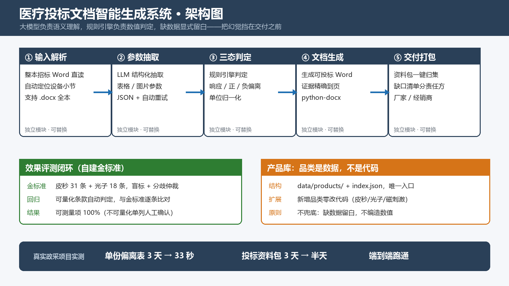

# 医疗投标文档智能生成系统

> 输入一份招标文件，输出可直接投标的技术偏离表 + 投标资料包 + 缺口清单。
> 一个人从需求到上线，已在真实政府采购项目中端到端使用。



---

## 一、问题（为什么做这个）

医疗设备投标的核心动作是**技术偏离表**：把招标文件里的几十到上百条技术要求，逐条与自家产品参数比对，判定"响应 / 正偏离 / 负偏离"，并附上证明材料出处。

这件事的现状是：

- 一份 30–80 项参数的偏离表，人工做 **2–3 天**，一家经销商一年要做十几份；
- **漏一条、答一句"满足"没有具体数值，投标直接无效**（这是招标文件的明文规定，不是概率问题）；
- 证明材料要找页码、找条款号，人工翻检测报告和说明书，极易出错；
- 结果高度依赖个人经验，人一走经验就没了。

我做这个系统的判断是：这件事 **90% 是格式与比对，10% 是判断**，而 90% 那部分恰好是大模型最擅长的；剩下 10% 应该交给规则和人工，而不是交给模型去猜。

---

## 二、我的角色

**独立完成，无团队。** 从需求定义、数据准备、Prompt 设计、规则引擎、文档生成、评测集建设到网页界面，全部自己写。

行业背景是这个项目的前提：我在医疗器械行业做了 6 年（强生临床技术支持 → 半岛医疗、伟思医疗区域销售），**知道一份标书为什么会被废、知道商务真正卡在哪一步**。这不是从外部调研得来的需求。

---

## 三、方案（五个模块）

| 模块 | 做什么 | 关键技术决策 |
|---|---|---|
| ① 输入解析 | 整本招标文件 Word 直读，自动定位设备小节并切分条款 | 不要求用户手工整理格式 |
| ② 参数抽取 | LLM 结构化抽取（含表格、图片型参数） | JSON Schema 约束输出 + 失败重试 |
| ③ 三态判定 | 规则引擎判定响应 / 正偏离 / 负偏离 | **数值判定不用模型**，用规则 + 单位归一化 |
| ④ 文档生成 | 输出可投标 Word，证明材料的证据精确到页码条款 | python-docx 精确控制格式 |
| ⑤ 交付打包 | 资料包归集 + 缺口清单，按厂家 / 经销商分列责任方 | 把"缺什么、谁去补"变成可执行清单 |

### 三个关键设计取舍（面试常问）

1. **数值判定不交给模型。** 模型只负责"这段文字在说什么"，"5–10mm 是否覆盖 3–8mm"由规则算。原因是模型算数会错，而这里错一个数就是废标。
2. **宁可留白，绝不编造。** 资料库里没有的参数，输出空白并标注"待确认"，而不是让模型"合理推断"。这条原则牺牲了自动化率，换来的是投标人敢用。
3. **品类是数据，不是代码。** 产品参数放在 `data/products/` + `index.json`，新增皮秒、光子、磁刺激等品类只加数据、不改代码。这是从"一个项目"变成"一个底座"的关键一步。

---

## 四、结果（可验证）

| 指标 | 结果 | 证据 |
|---|---|---|
| 单份偏离表制作时间 | **3 天 → 33 秒**（18 条参数） | 真实政采项目实测 |
| 投标资料包整理时间 | **3 天 → 半天** | 同上 |
| 参数判定准确率 | **可测量项 100%**（皮秒 31 条 + 光子 18 条金标准） | `evidence/eval_report.json` |
| 不可量化条款 | 单独标注、交人工确认，不纳入自动判定 | `evidence/eval_gold.json` |
| 使用状态 | 已在真实政府采购项目中端到端跑通 | `samples/` |

**关于"100%"的诚实说明**：这个数字只覆盖"可量化条款"（有明确数值和单位的），不可量化条款（"性能稳定""操作简便"这类）我主动剔除出评测集，单独标记人工确认。**分母是我定义的金标准子集，不是全部条款**——面试时必须这么讲，否则一被追问就塌。

---

## 五、技术栈

Python · 大模型 API（结构化输出 / 重试）· 规则引擎（单位归一化 + 区间判定）· python-docx / openpyxl · FastAPI + 网页界面 · Docker

**没有用**：向量数据库（这个场景不需要语义检索，规则更快更准）、微调（成本远高于收益）。

---

## 六、踩过的坑（面试真题）

1. **正则漏字**：`<w:t>` 匹配不到带属性的标签，导致 docx 解析少字 → 改成 `<w:t(?:\s[^>]*)?>`。
2. **红字语义错**：一开始把"符合"的条目也标红了，语义反了 → 红字只用于"不满足"，符合项一律正常色。
3. **品类硬编码**：第一版把皮秒参数写死在代码里，加光子就要改 4 个文件 → 重构为 `product_db` 单一入口，全部走数据。
4. **评测被我自己的标准骗过一次**：最早的金标准是我边看边标的，等于自己考自己。后来改成盲标 + 分歧仲裁，准确率从"看起来 100%"变成"真的 100%"。

---

## 七、如果重做，我会改什么

- 评测集从 49 条扩到 8 份历史标书全量回归（当前只覆盖两个品类）；
- 把"缺口清单"做成可追踪的看板（谁负责、什么时候补），而不只是一张表；
- 输入侧支持扫描件 OCR（现在只吃电子版 Word/Excel）。

---

## 八、目录说明

```
portfolio/
├── README.md            本文件（案例说明）
├── architecture.png     架构图
├── screenshots/         输入样例截图（输出截图待补）
├── samples/             真实产出样例（可投标 Word）
└── evidence/            评测原始数据（金标准 + 回归结果）
```

> 说明：仓库内 `data/` 含真实招标文件与客户资料，仓库保持 Private。
